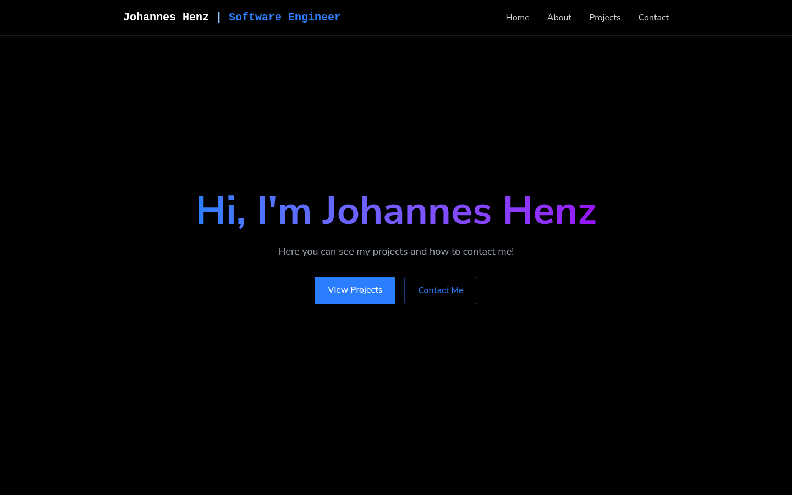

# Portfolio

My personal portfolio website, built with React and Tailwind CSS and deployed to GitHub Pages.

**Live site: [johanneshenz.github.io/Portfolio](https://johanneshenz.github.io/Portfolio/)**



## Features

- Single-page layout with Home, About, Projects and Contact sections
- Animated loading screen and reveal-on-scroll transitions (Intersection Observer)
- Responsive navigation with a mobile menu
- Working contact form that sends email through EmailJS, with no backend needed

## Tech stack

React 19 · Vite 6 · Tailwind CSS 4 · EmailJS · GitHub Pages

## Running locally

```bash
npm install
cp .env.example .env   # add your EmailJS IDs for the contact form
npm run dev
```

## Deployment

```bash
npm run deploy
```

This builds the site and publishes `dist/` to the `gh-pages` branch with [`gh-pages`](https://github.com/tschaub/gh-pages).

## Project structure

```
src/
├── App.jsx                 # page layout and loading state
├── components/
│   ├── LoadingScreen.jsx
│   ├── Navbar.jsx, MobileMenu.jsx
│   ├── RevealOnScroll.jsx
│   └── sections/           # Home, About, Projects, Contact
└── index.css               # Tailwind setup and custom animations
```
